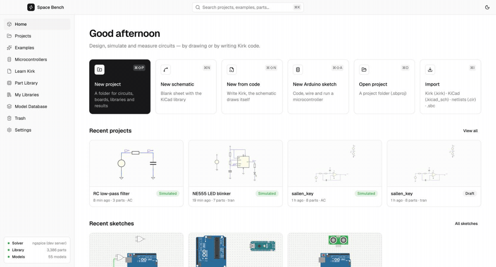
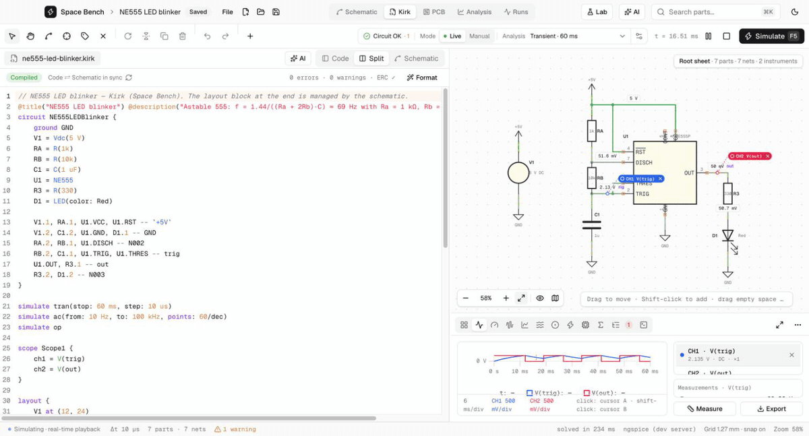
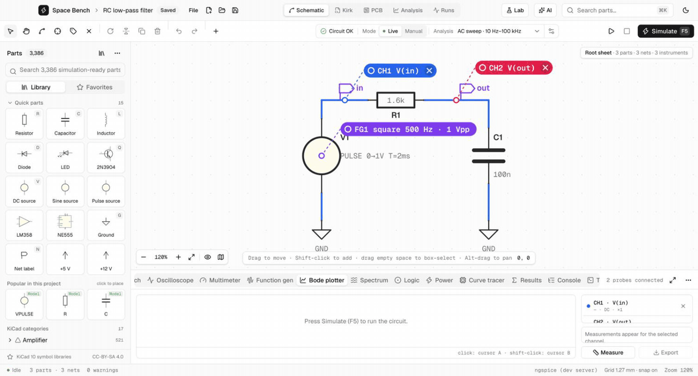
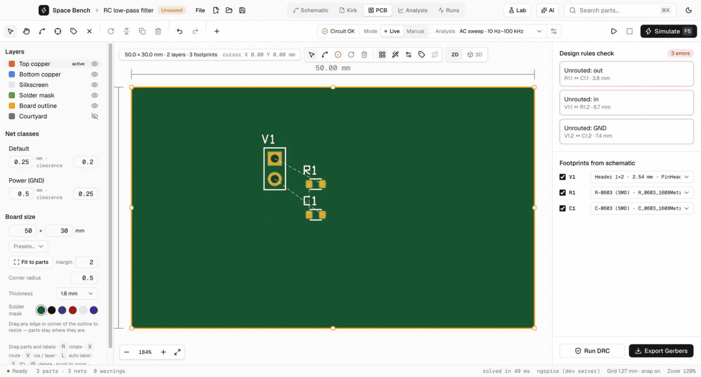
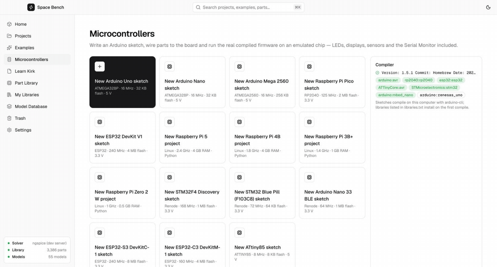

# Space Bench

**Design, simulate and build electronics in one free desktop app — schematics, SPICE simulation, a circuit
language, virtual instruments, PCB layout and microcontrollers running their real firmware.**

<p align="center">
  
</p>

Draw a schematic with the KiCad symbol library or write it as code in **Kirk**; simulate it on **ngspice**; probe
it with an oscilloscope, Bode plotter and multimeter; lay out a PCB and export Gerbers — and program Arduino,
Raspberry Pi Pico, ESP32, STM32 and Raspberry Pi boards whose real firmware runs in an emulator right next to
the circuit.

> **Status:** early development (v0.1). Everything described here runs today; file formats may still change.
> Licence: [MIT](LICENSE) — free for any use. Third-party parts: [THIRD_PARTY_NOTICES.md](THIRD_PARTY_NOTICES.md).

---

## Contents
- [Features](#features)
- [Supported systems](#supported-systems)
- [Getting started](#getting-started)
- [Repository layout](#repository-layout)
- [Licence and credits](#licence-and-credits)

---

## Features

### Schematic capture
- **22,905 KiCad symbols** loaded on demand (3,386 ready to simulate), with a searchable part browser and favourites.
- Wiring that follows KiCad's rules (wire ends join, crossings don't, labels and power symbols connect by name),
  junction dots, ERC, undo / redo, multi-unit ICs, rotate / mirror, copy / paste.
- Inspector with SI-unit fields, tolerances, footprints and any custom field (MPN, manufacturer …), plus a
  live-tune slider for any value.
- **KiCad files:** import a `.kicad_sch` (KiCad 6–9) — symbols, values, footprints, fields, `Sim.*` models, wires,
  labels, power symbols, no-connects and its `.tran` / `.ac` / `.op` directive — and export any circuit as a
  KiCad 8 `.kicad_sch`. SPICE netlists (`.cir`, `.sp`, `.net`) import too.

### Simulation (ngspice)
- **Transient, AC, DC sweep and operating point**, through **libngspice** inside the app or `ngspice -b`.
- **Live mode:** change a value and the circuit re-simulates at once; wires are coloured by voltage, LEDs glow,
  lamps, motors and speakers react, and transients play back in real time.
- **Parameter sweeps, Monte Carlo** (from part tolerances) and **temperature** runs, overlaid on one plot.
- Models for common BJTs, MOSFETs, JFETs, diodes, LEDs, op-amps, 555 timers and regulators are inferred from the
  part value; anything with KiCad `Sim.*` fields simulates as-is. A model database lets you add your own.
- **Stimulus:** drive any source, sensor or control over time — ramps, steps, sines, square waves, noise, random
  walks, recorded samples or CSV data.
- **Sensors** that read a virtual room: light, temperature, sound, humidity, pressure, magnetic field, distance,
  force, acceleration, gas, motion, touch, liquid level, moisture and current.

### Kirk — circuits as code
<p align="center"><br><sub>Change a value in the code — the schematic and the running simulation follow.</sub></p>

A small language (`.kirk`, after Kirchhoff) that describes a circuit. The schematic draws itself from the code
and edits to the drawing flow back into the code.

```kirk
circuit Blinker555 {
    supply VCC = 5 V
    ground GND
    U1 = NE555
    R1 = R(1k)
    R2 = R(10k)
    C1 = C(10 uF)
    R3 = R(330)
    D1 = LED(color: red)

    VCC -- R1 -- DISCH -- R2 -- TRIG -- C1 -- GND
    U1.OUT -- R3 -- D1 -- GND
    U1.VCC, U1.RST -- VCC
    U1.DISCH -- DISCH
    U1.THRES, U1.TRIG -- TRIG
    U1.GND -- GND
    U1.CONT -- nc

    parts(R*).footprint = "Resistor_SMD:R_0603_1608Metric"   // set a property on a whole selection
    check connected(U1.OUT, R3.1)                             // design rules, checked on every compile
}
simulate tran(stop: 500 ms, step: 20 us)
measure freq = frequency(V(OUT), at: 2.5 V)
assert  freq in 6.5 Hz .. 7.2 Hz
```

- Parts, chains, pins by name or number, nets, supplies, ground, no-connects.
- **Scripting:** `for` loops that generate parts and wiring, properties on one part (`R1.MPN = …`) or a selection
  (`parts(C*, value: 100n, on: VCC).footprint = …`), and `check` design rules (`connected(…)`,
  `parts(C*).footprint`, `parts(R*).count == 8`).
- **Components:** reusable sub-circuits with typed parameters, compiled to SPICE subcircuits; **libraries** and
  imports.
- `simulate`, `measure` (frequency, duty, rise time, gain, phase, −3 dB point …), `assert`, `sweep`,
  `montecarlo`, `temp`, `stimulus { }`, `environment { }`, and instruments (`scope`, `meter`) in code.
- An editor with highlighting, completion, hover readings, inline results and error explanations; a
  **Learn Kirk** tutorial and cheat sheet. Language reference: [`docs/kirk-language-spec.md`](docs/kirk-language-spec.md).

### Instruments and analysis
<p align="center"><br><sub>AC sweep of an RC low-pass: Bode plot, measured −3 dB point (994.7 Hz) and a cursor at 1 kHz.</sub></p>

- **Oscilloscope**, **Bode plotter**, **multimeter**, **function generator**, **spectrum analyser** (FFT / THD),
  **logic view**, **power table** and **curve tracer** — probe any wire or part.
- **Analysis view** for result sets, **Runs** history, CSV / JSON / MATLAB export and an HTML report.
- **Lab window:** list every input of the circuit (supplies, sensors, controls), drive them over time and check
  every part's voltage, current and power against its ratings.

### PCB
<p align="center"><br><sub>From ratsnest to routed board (design-rule check: 0 errors) and the 3D view.</sub></p>

- Footprints from the schematic, smart placement, ratsnest, an **A\* auto-router**, net classes, design-rule
  checks and a **3D board view**.
- **Gerber X2 + Excellon** export.

### Microcontrollers and boards
<p align="center"><br><sub>Real Arduino firmware running — the live code view shows each pin's state as it changes.</sub></p>

- A Wokwi-style workspace: write the sketch in Monaco, wire boards and **470+ catalogue parts** (sensors, displays,
  motors, I²C / SPI / UART chips, logic gates, passives …) on a canvas, compile with `arduino-cli` and run the
  **real firmware**. 37 ready examples.
- **Live code view:** while a sketch runs, every line that uses a pin shows its state in colour — HIGH / LOW,
  PWM duty, analog voltage and ADC value, pin mode, the latest Serial output — and the part of `loop()` that just
  ran lights up.
- Serial Monitor, logic analyser with VCD export, breadboards, several boards per sketch, Fritzing part import,
  and **Check with ngspice** to simulate the running circuit exactly.

| Board | Runs on |
|---|---|
| Arduino Uno, Nano, Mega 2560 (+ compatibles), ATtiny85 | avr8js |
| Raspberry Pi Pico, Seeed XIAO RP2040 | rp2040js (USB serial, PIO) |
| ESP32 DevKit V1 / DevKitC / ESP32-CAM / Lolin32, ESP32-S3, ESP32-C3 | Espressif's QEMU + a GPIO bridge |
| STM32F4 Discovery, STM32 Blue Pill, Arduino Nano 33 BLE (nRF52840) | Renode |
| **Raspberry Pi 5, 4B, 3B+, Zero 2 W** | **Linux in a VM** (QEMU): Debian + gpiozero / lgpio / RPi.GPIO, GPIO through the circuit |

### Circuit + firmware together
Place a board in a schematic, write its program in the **Firmware** panel and press **Run**: the real firmware
(or Linux program) runs on its emulator while ngspice simulates the whole circuit around it, frame by frame. The
scope, meters, wire colours, LED glow and the live code view show the result as it happens. Try
**Examples → Microcontrollers → Arduino PWM DAC**.

### AI assistant (optional)
Describe a circuit or paste a photo of a schematic: Claude writes the Kirk program, simulates it, reads the
numbers and fixes what is off; in the Microcontrollers workspace it writes the sketch and the wiring, and it can
fix compile or run errors. It uses your own Claude Code login or Anthropic API key, asks before installing
anything, and nothing is sent until you press **Send**.

---

## Supported systems

| System | Status |
|---|---|
| **macOS** 12+ (Apple Silicon and Intel) | developed and tested here — every feature works |
| **Linux** (x86-64 / arm64) | builds with Tauri; schematic, simulation, Kirk, PCB and Arduino are expected to work — **not yet tested**; the Raspberry Pi VM and Renode need manual installs |
| **Windows** 10 / 11 | builds with Tauri; schematic, simulation, Kirk and PCB are expected to work — **not yet tested**; ESP32, Raspberry Pi and Renode boards are not supported yet |

Reports and pull requests for Linux and Windows are very welcome.

---

## Getting started

### Prerequisites
| Tool | Why | macOS | Linux (Debian / Ubuntu) | Windows |
|---|---|---|---|---|
| Node.js 22+ and pnpm | the UI | `brew install node pnpm` | [nodejs.org](https://nodejs.org), `npm i -g pnpm` | [nodejs.org](https://nodejs.org), `npm i -g pnpm` |
| Rust (stable 1.90+) | the desktop shell | [rustup.rs](https://rustup.rs) | [rustup.rs](https://rustup.rs) + [Tauri's Linux packages](https://tauri.app/start/prerequisites/) | [rustup.rs](https://rustup.rs) + [Tauri's prerequisites](https://tauri.app/start/prerequisites/) |
| **ngspice** | simulation (required) | `brew install ngspice` | `sudo apt install ngspice libngspice0` | [ngspice.sourceforge.io](https://ngspice.sourceforge.io/download.html) (Spice64) |
| arduino-cli *(optional)* | compiling sketches | `brew install arduino-cli` | [arduino.github.io/arduino-cli](https://arduino.github.io/arduino-cli/latest/installation/) | same |
| QEMU *(optional)* | Raspberry Pi boards | `brew install qemu` | `sudo apt install qemu-system-arm` | — |
| Espressif QEMU, Renode *(optional)* | ESP32, STM32 / nRF52 | Settings → Microcontrollers → Install | same / [renode.io](https://renode.io) | — |

The app finds ngspice on `PATH` and in the usual install folders; set `SPICEBENCH_NGSPICE` (program) or
`SPICEBENCH_LIBNGSPICE` (shared library) to use another one. Board cores (AVR, RP2040, ESP32) install from the
Microcontrollers page.

### Run
```sh
git clone https://github.com/techkush/spacebench.git
cd spacebench
pnpm install
pnpm dev          # builds the Rust side and opens the app, with hot reload
```
`pnpm dev` also serves the UI at <http://localhost:5173>; in a browser, the dev server stands in for the desktop
commands (ngspice, arduino-cli, QEMU), so almost everything can be tried there too.

### Build an installer
```sh
pnpm build        # → target/release/bundle (.app / .dmg, .deb / .AppImage, .msi / .exe)
```

### Test
```sh
pnpm test                      # Vitest: editor, netlister, Kirk, KiCad import/export, PCB, examples on ngspice, microcontrollers
cargo test -p spicebench       # the ngspice bridge
cargo test -p sb-engine        # the experimental simulation engine, against analytic solutions
```
Tests that need ngspice, arduino-cli or board cores are skipped when those aren't installed.

---

## Repository layout
```
apps/desktop/                 the Tauri 2 app
  src/
    components/               React UI (shadcn/ui + Tailwind)
    editor/                   schematic model, netlist, file format, examples
    kirk/                     the Kirk language: lexer, parser, compiler, scripting, generator, auto-layout
    kicad/                    KiCad .kicad_sch import / export (S-expressions, symbol conversion)
    lib/                      ngspice bridge, SPICE netlister and models, results, instruments, projects, AI
    lab/                      the Lab window
    pcb/                      footprints, placement, router, DRC, Gerber export, 3D
    mcu/                      microcontroller workspace: emulators, circuit solver, parts catalogue, live code view
    cosim/                    circuit + firmware co-simulation
    linux/  renode/           Raspberry Pi VM and Renode boards
  linux-guest/                files installed in the Raspberry Pi VM
  src-tauri/                  Rust shell: ngspice, arduino-cli, QEMU, Renode, Claude Code
  public/kicad/               KiCad symbols, converted (CC-BY-SA 4.0 — see THIRD_PARTY_NOTICES.md)
engine/                       sb-engine — an experimental simulator in Rust (MNA, Newton, transient, AC)
scripts/                      build-kicad-symbols.mjs
docs/                         user guide, Kirk language reference, demo GIFs (docs/media)
```

Documentation: [User guide](docs/user-guide.md) · [Kirk language reference](docs/kirk-language-spec.md)

---

## Contributing
Issues and pull requests are welcome — see [CONTRIBUTING.md](CONTRIBUTING.md). Please read the
[code of conduct](CODE_OF_CONDUCT.md), and report security problems as described in [SECURITY.md](SECURITY.md).

## Licence and credits
- **Space Bench** is released under the **[MIT licence](LICENSE)**.
- The bundled **KiCad symbol libraries** (`apps/desktop/public/kicad/`) stay under **CC-BY-SA 4.0** with the KiCad
  library exception ([licence](apps/desktop/public/kicad/LICENSE.md)). Circuits you draw with them, and files you
  export, are yours without restriction.
- Every library, tool, data set and reference used to build Space Bench — with its licence and authors — is listed
  in **[THIRD_PARTY_NOTICES.md](THIRD_PARTY_NOTICES.md)**. Special thanks to the KiCad, ngspice, Wokwi (avr8js,
  rp2040js), QEMU, Renode, Tauri and React communities, and to
  [kicad-skip](https://github.com/psychogenic/kicad-skip) for the ideas behind Kirk's scripting.

Space Bench is not affiliated with KiCad, Arduino, Raspberry Pi, Espressif, Wokwi or Anthropic; their names are
used only to describe compatibility.
